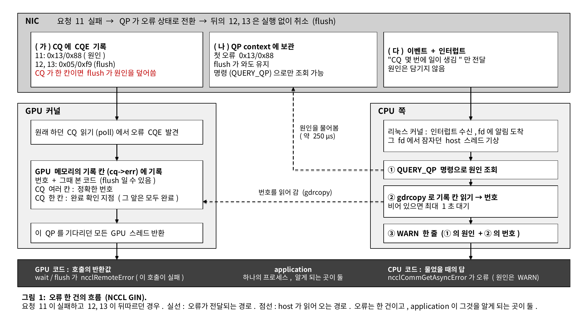
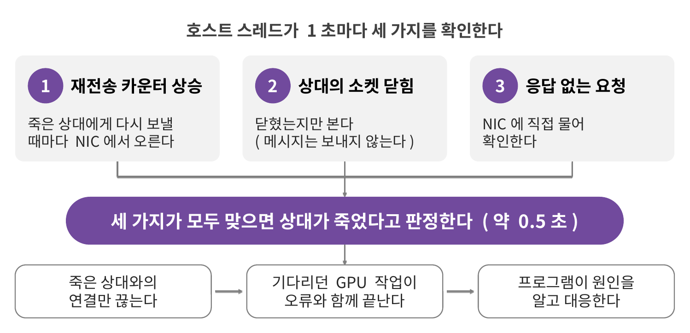
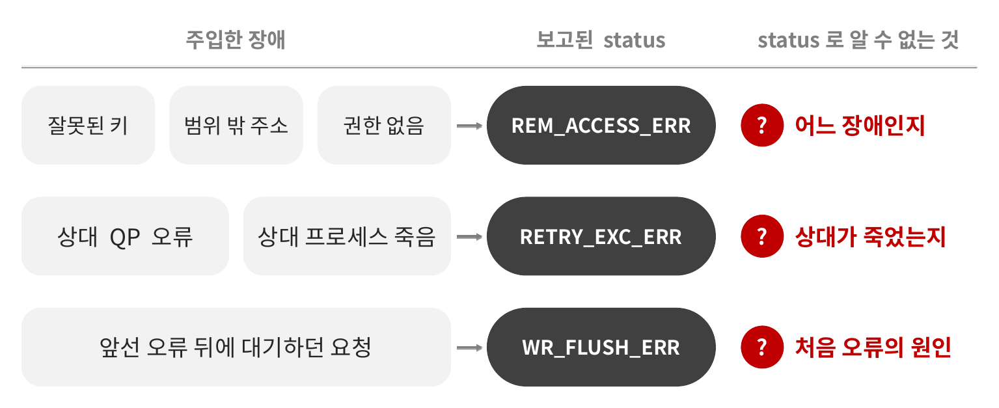
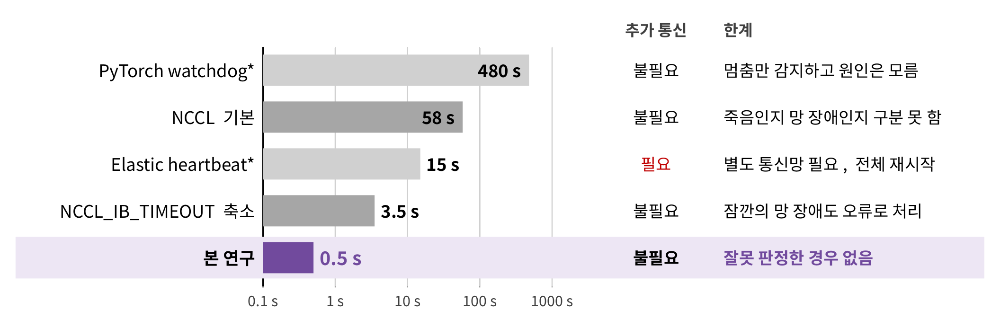
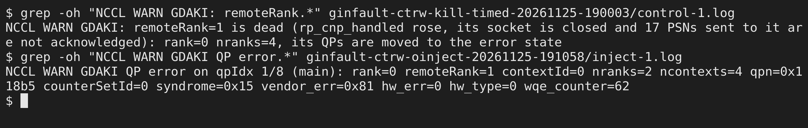

# v2: 원본 소스에서 다시 만드는 오류 전달과 죽음 판정

NCCL v2.32.6-1과 NVSHMEM v3.8.0-0의 release 소스에서 출발한 작업. v1의 복구 패치와 설계는 미참고.
현재까지의 범위는 **오류가 application까지 원인과 함께 전달되게 하는 것**과 **상대 프로세스의 죽음을 일찍 알아채는 것**(NCCL GIN).
투명 복구(실패한 QP를 다시 세워 떠 있던 요청을 이어 보냄)는 설계와 측정까지 하고 만들지 않음(`RECORD.md` 4.3절).

기록은 [`RECORD.md`](RECORD.md) 한 파일: 결정, 분류의 근거, 날짜별 실행 기록.

## 파일

| 경로 | 내용 |
|---|---|
| `RECORD.md` | 단일 기록. 4절이 오류 분류의 근거, 4.1절이 분류 규칙, 4.2절이 상대 죽음의 판정과 그 뒤, 4.3절이 투명 복구를 만들지 않는 근거와 측정, 6절이 실행 기록 |
| `patches/nccl-v2.32.6-1.diff` | NCCL `ad2d192`(v2.32.6-1) 대비 변경. 17개 파일 +558 −59 |
| `patches/nvshmem-v3.8.0-0.diff` | NVSHMEM `270759e5`(v3.8.0-0) 대비 변경. 16개 파일 +294 −11 |
| `docs/*.png` | 그림 다섯 장: 오류 전달 경로, 같은 status로 보고되는 장애, 죽음 판정, 감지 방법 비교, 실행 로그의 터미널 화면 |
| `repro/gin_fault.cu` | nccl#2483 재현: 창 밖 주소로 put을 보낸 뒤 flush와 host 조회의 반환 확인. rank를 실행 도중 죽이는 시험, shrink와 grow, counter 대기도 포함(env는 파일 첫머리) |
| `repro/shmem_fault.cu` | nvshmem#120 재현: 잘못된 주소 또는 정렬 안 된 atomic, 스레드 수 조절 |
| `repro/synd.c`, `synd.sh` | CQE syndrome 13개 재현 시도(CPU verbs, 한 프로세스 loopback). CQE, QP context의 오류 기록, 비동기 이벤트, 포트 카운터, 커널 로그를 경우마다 기록. `psn_*`·`sqctr*`·`noplap*`·`psnmap` 경우: 순번을 이어 한쪽 QP만 다시 세우기, RESET 뒤 NIC의 SQ 번호 |
| `repro/xnode.c`, `xnode.sh`, `xnode_sum.py` | 두 장비 사이에서 한쪽 QP만 다시 세우기 측정(CPU verbs, 양방향 전송 도중 ERR·RESET)과 그 요약 표 |
| `repro/qperr.c` | LD_PRELOAD 주입기. 프로세스의 QP를 실행 중에 오류 상태로 바꿔 "연결 쪽 문제"를 재현(라이브러리 코드 변경 없음) |
| `repro/decode_test.cpp` | NVSHMEM 분류 표의 자체 검사(GPU와 NIC 불필요) |
| `repro/dev0.c` | LD_PRELOAD shim. GPU 한 장에 rank 여러 개를 올릴 때 NCCL 예제가 device 0을 쓰게 함 |
| `repro/watch_counters.sh`, `repro/nsys_rank.sh` | 포트 카운터의 변화만 출력, MPI rank 하나만 Nsight로 실행 |
| `repro/build.sh` | 재현 프로그램 빌드 |
| `run_gin_fault.sh`, `shmem_fault.sh`, `shmem_cnt.sh` | 재현 실행과 집계 |
| `ab.sh`, `ab_report.py` | 원본과 수정본을 번갈아 돌리는 성능 비교와 중앙값 표 |
| `accept.sh`, `baseline.sh` | 장애 시나리오 표(S1–S4는 투명 복구가 있어야 통과해 불합격으로 남음, S5·S6 통과)와 비용 기준값(정상 경로, 초기화, 메모리, 오류 스레드 CPU, 장애 뒤 대기 시간) |
| `env.sh`, `verify.sh`, `shmem_sunny.sh`, `socks.sh` | 실행 환경, 첫 동작 확인, 보조 스크립트 |

스크립트의 가정: `~/rdma-recovery/` 아래에 `nccl/`, `nvshmem/`(패치 적용본), `base/`(원본 빌드), `repro/`, host 이름은
`rain`과 `sunny`. 다른 환경에서는 경로와 host 이름 변경 필요.

패치 적용:

```
git clone https://github.com/NVIDIA/nccl && cd nccl && git checkout ad2d192 && git apply ../patches/nccl-v2.32.6-1.diff
git clone https://github.com/NVIDIA/nvshmem && cd nvshmem && git checkout 270759e5 && git apply ../patches/nvshmem-v3.8.0-0.diff
```

## 고친 이슈

| 이슈 | 증상 | 고친 내용 |
|---|---|---|
| [NVIDIA/nvshmem#117](https://github.com/NVIDIA/nvshmem/issues/117) | CPU 프록시가 doorbell record의 틀린 word에 기록, 장애 뒤 오류 CQE가 생기지 않고 `nvshmem_quiet()` 정지 | 주소 계산 2줄. upstream 수정은 devel 브랜치에만 있고 release 3.8.0에는 없음. 장애를 넣어 확인하지는 않음 |
| [NVIDIA/nvshmem#120](https://github.com/NVIDIA/nvshmem/issues/120) | release 빌드가 오류 CQE를 읽고 버림. quiet는 정상 반환, fetch는 틀린 값 | GPU 코드의 첫 오류 기록, host가 원인을 출력하고 중단(기본). `NVSHMEM_IBGDA_ABORT_ON_OP_ERROR=0`이면 계속 실행하며 application이 `nvshmemx_get_op_error()`로 조회 |
| [NVIDIA/nccl#2483](https://github.com/NVIDIA/nccl/issues/2483) | GIN GDAKI에서 실패한 put을 device 코드가 알 수 없고 대기가 끝나지 않음. host는 10 s 조회에서 한 번만 확인 | 첫 오류를 CQ에 기록, 반환값이 있는 flush와 wait의 `ncclRemoteError` 반환, host 경고에 원인 출력(조회 간격 기본 10 s → 1 s). CQ 방식 3가지 모두 |
| [NVIDIA/nccl#2480](https://github.com/NVIDIA/nccl/issues/2480) | `NCCL_GIN_GDAKI_NIC_HANDLER=6`이 init을 통과한 뒤 조용히 정지 | 지원하지 않는 값을 경고와 함께 거절. upstream 수정은 dev 브랜치 |

고친 뒤 오류 한 건이 전달되는 경로(NCCL GIN). 실선은 오류의 전달, 점선은 host의 조회.



## 이슈 밖에서 더한 것 (NCCL GIN GDAKI)

- **host 오류 스레드.** context마다 스레드 하나가 NIC의 오류 이벤트에서 잠들어 있다가 QP 오류를 원인과 함께 경고로 출력. application이 `ncclCommGetAsyncError`를 부르지 않아도 동작. 장애 없는 실행 한 번에 스레드당 CPU 약 89 us(51–129 us; 1 s마다 포트 카운터를 읽음).
- **상대 죽음의 판정.** 원본은 죽은 rank에게 보낸 요청이 NIC의 재시도 한도(약 1분)까지 정지. 스레드가 1 s마다 포트 카운터 `rp_cnp_handled`를 읽고, 올랐을 때 이웃 소켓이 닫혔고 그 rank로 보낸 PSN 중 ACK를 못 받은 것이 있으면(QUERY_QP) 죽음으로 판정, 그 rank로 가는 QP만 오류 상태로 전환. 소켓으로 보내는 것은 없음.

  

- **죽음 뒤의 shrink.** 오류가 기록된 communicator도 `ncclCommShrink(NCCL_SHRINK_ABORT)`는 수락.
- **강제 shrink 예외의 범위.** 위 예외는 초기화가 성공으로 끝난 communicator에만 적용. 초기화 실패 뒤의 강제 shrink: 고치기 전
  `ncclSuccess`와 NULL communicator(2/2), 고친 뒤 `ncclRemoteError`(2/2).
- **실패 뒤의 counter 대기.** counter 값만 보는 `waitCounter`는 QP 오류나 죽음 판정에도 끝나지 않았음(제한 시간이 없으면 멈춤).
  host가 실패를 device context의 `failed` 바이트(구조체의 빈 자리, 크기 88바이트 그대로)에 적고, 대기가 abort flag와 같은 주기(폴링
  10000번에 한 번)로 읽어 `ncclRemoteError`로 끝남.

## 측정으로 확인한 것

- **원인은 QP context에 보존.** CQ 칸이 하나뿐인 구성(NVSHMEM 기본)에서는 뒤따른 flush가 원인 CQE를 덮어씀. NIC는 QP마다
  첫 오류를 QP context에 보관(`QUERY_QP`의 `qpc_ext`)하고 flush는 그것을 지우지 않음. 두 라이브러리의 host가 이 값을 조회.
  NVSHMEM에서 스레드 8개와 64개로 장애를 넣은 결과: 고치기 전 매번 flush만 관측, 고친 뒤 매번 원인 복원.
- **오류 분류의 근거.** 전체 집합은 드라이버가 정의한 CQE syndrome 13개. 그중 10개를 소프트웨어로 재현. 두 라이브러리의
  GPU 경로(write, read, atomic만 사용, 수신 큐 없음)가 낼 수 있는 것은 6개(`RECORD.md` 4절).
- **오류 주입 재시험.** NCCL CQ 방식 3가지 × 양방향 120회에서 멈춤 0회, host 조회 90회 모두 원인(`0x13/0x88`) 출력.
  host 스레드를 넣은 뒤의 82회(장애 70회)에서도 멈춤 0회, 경고 한 번씩, 원인 일치.
- **같은 코드, 다른 원인.** 서로 다른 장애가 같은 status로 보고됨(`repro/synd.c`).

  

- **세 분류의 재현.** 요청이 틀린 경우(`0x13`, `0x12`), 상대 프로세스 종료(`0x15/0x81`), 연결 쪽 문제(보내는 쪽 QP 오류
  `0x05/0xf5`, 받는 쪽 QP 오류 `0x15/0x81`)를 두 라이브러리에서 재현. 분류 결과는 모두 기대와 일치, 멈춤 0회.
- **어디까지 끝났는지는 하한으로 기록.** 오류 기록의 요청 번호는 "그 아래는 모두 완료"를 뜻하는 하한. put 수만 개가
  떠 있는 도중에 QP를 죽인 50회 모두에서 기록된 번호가 실제 도착분 이하(NCCL 기본 CQ는 정확히 일치).
- **상대 죽음은 약 0.5 s에 판정.** rank 4개에서 받는 rank를 전송 도중 SIGKILL(8회): 보내던 rank만 경고 한 줄, flush 정지 0.49–0.72 s(원본은 약 58 s). 같은 포트의
  다른 job이 카운터를 올리는 중에도 동일. 판정의 근거 신호: 사라진 QP로 가는 재전송마다 보내는 쪽 포트의 `rp_cnp_handled`가 +1, 첫 상승은 죽은 뒤 0–20 ms.
- **죽음 오판은 0회.** 장애 없는 실행, 상대가 살아 있는 QP 오류, 이웃의 정상 종료(flush 대기와 counter 대기, 카운터 잡음 유무) 모두. 이전 구현은 요청이
  떠 있는지를 GPU 쪽 번호로 판단해 counter 대기 + 정상 종료 + 잡음에서 3회 중 3회 오판, NIC의 PSN으로 바꾼 뒤 0회.
- **다른 감지 방법과의 비교.** 상대의 죽음을 아는 시간과 조건. `*`는 소스에서 읽은 기본값(PyTorch v2.6.0 `ProcessGroupNCCL`의
  heartbeat 감시 480 s, TorchElastic dynamic rendezvous의 keep-alive 5 s × 3회)이고 이 장비에서 잰 값이 아님. NCCL 기본 약 58 s,
  `NCCL_IB_TIMEOUT=14`에서 3.5–3.8 s, 이 작업 약 0.5 s는 측정. 별도 제어 통신 없이, GPU 경로에 코드를 더하지 않고, 오판 없이 판정
  (`RECORD.md` 4.2절).

  

- **실제 로그.** 2026-11-25 실행의 두 경고를 터미널에서 `grep`한 화면. 위: rank가 전송 도중 죽었을 때의 판정 경고. 아래: 상대가 살아
  있는 QP 오류의 원인 경고.

  

- **한쪽만 다시 세우기의 범위(투명 복구를 만들지 않은 근거).** 두 장비 사이 860회. 되는 것: ERR 상태의 QP context에서 읽은 순번은
  정확(380/380). 그 순번을 이어 다시 세우면 한 패킷짜리 write는 230개 흐름 모두 정확히 한 번, 응답 쪽을 다시 세우지 않으면 atomic도
  정확히 한 번(30/30). 안 되는 것: 64 KiB write는 이어 보낼 위치가 70회 중 20회 메시지 중간이라 오류 없는 데이터 손상 16회, 재실행 2회.
  응답 쪽을 다시 세운 뒤의 atomic은 이중 실행은 없으나(0/400) 30회 중 28회 끝나지 않음.
- **정상 경로 비용.** NCCL `ring_exchange` 원본 대비 +0.7%, +0.6–0.9%, +0.2–0.3%, +0.1%(구성 4가지, 20회씩 두 번, 원본의 회차 간 편차
  0.1–3.5%). 이 예제의 device 코드는 counter 대기 수정 전후가 바이트까지 같음. 값은 코드 배치에 따라서도 움직임: 실패 경로 코드를 빼기
  전(같은 날) 구성 1·2는 +0.1%, +0.8–1.1%이었고, 구성 1의 차이(약 0.8 us)는 명령 수가 아니라 배치의 효과로 추정. counter 대기 자체
  (`waitCounter`): 제한 시간 없음 +0.2%(대기당 약 20 ns), 제한 시간 있음 차이 없음. NVSHMEM put 지연 +1.1%, p 지연 +1.7%, 대역폭은
  편차 안(10회).

## 한계

- 소프트웨어로 넣은 장애만 대상. 케이블이나 펌웨어 결함 같은 물리 장애는 미포함
- vendor_err 값은 드라이버 헤더에 정의가 없어 측정으로 정한 값. ConnectX-6(MT4123) 펌웨어 20.43.4100 한 가지에서 측정
- 노드 2개에서만 실행(NCCL은 GPU 한 장에 rank 둘을 올린 rank 4개까지, NVSHMEM은 GPU 한 장에 PE 둘). 스위치 없는 직결 링크
- 죽음 판정: 전송 도중 죽은 rank를 그 rank에게 보내던 ring 이웃이 판정. counter 대기(`waitCounter`)도 판정과 QP 오류로 풀림(돌던
  대기가 죽은 뒤 약 0.5 s에 끝남(대기 시작 기준 538–565 ms, 8회); 고치기 전은 멈춤). host 오류 스레드가 없는 구성(completion channel
  없음, SDK 방식)은 application이 `ncclCommGetAsyncError`를 불러야 풀림(코드로 판단). signal 대기(`waitSignal`)는 그대로(자기 제한
  시간으로만 끝남, 돌려 보지 않음). 스위치가 있어 혼잡이 카운터를 올리는 망은 미확인(이 직결 링크에서는 실제 부하가 카운터를 올리지 않음)
- 실패한 요청을 정확히 짚지는 못함. 기록은 "여기까지는 끝났다"는 하한이며, 그 뒤 구간의 요청은 완료 여부 미확정
- 투명 복구는 만들지 않음(근거와 측정은 `RECORD.md` 4.3절). 죽은 rank의 교체는 step 재실행 위에서 가능(shrink 12–66 ms(중앙값 약
  20 ms), grow 328–335 ms; 죽음 → shrink → grow를 한 실행에서 이어서도 확인, application 상태 복사는 미확인). 같은 번호로 끼워
  넣는 제자리 교체는 범위 밖. 장애는 모두 소프트웨어로 주입(실제 경로 고장은 재시도가 끝난 뒤, 약 47 s 뒤에야 `0x15`)
- 별도 통로로 양쪽이 합의해 QP를 함께 다시 세우는 방식은 한쪽 재구성의 막힘 둘(양방향 QP, 메시지의 첫 순번)을 풀 수 있으나
  (추론, 미측정) 만들지 않고 향후 연구로 남김. 작업은 진단과 빠른 죽음 판정으로 마무리(`RECORD.md` 4.3절)
- 비교에 쓴 PyTorch와 TorchElastic의 감지 시간은 소스의 기본값이고 이 장비에서 재지 않음
- 실행 로그는 미공개(관리망 주소 포함). `RECORD.md`가 가리키는 `runs/...` 경로는 이 저장소에 없음
